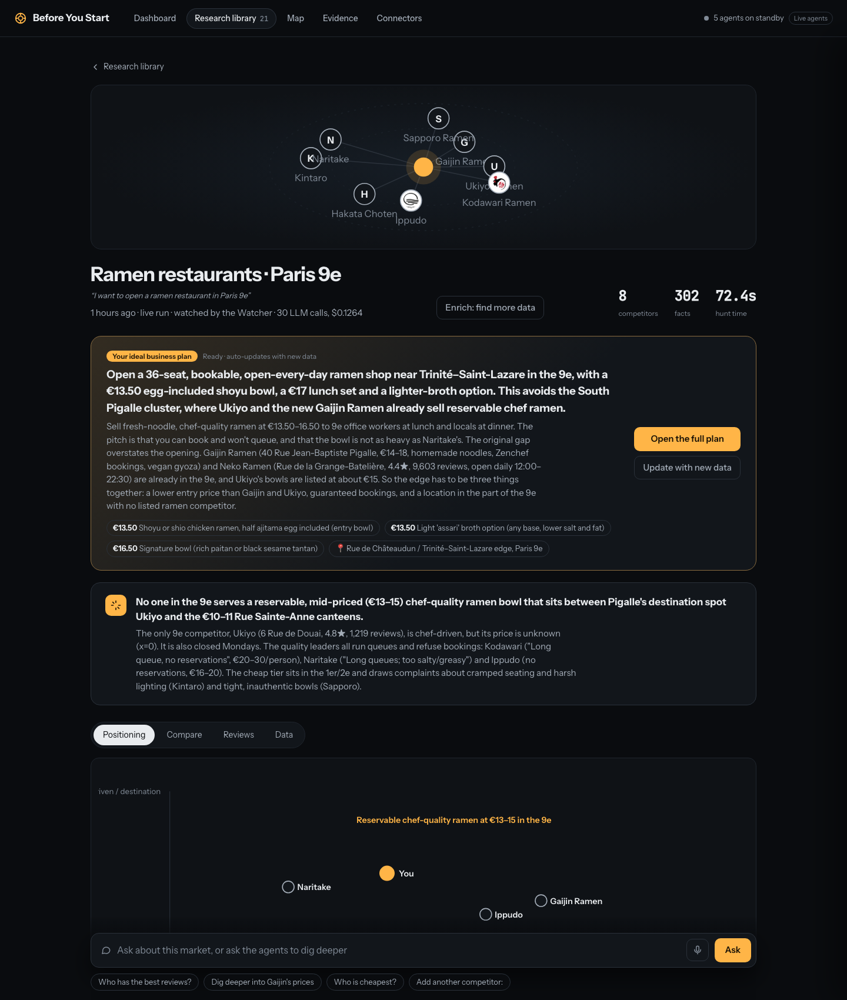
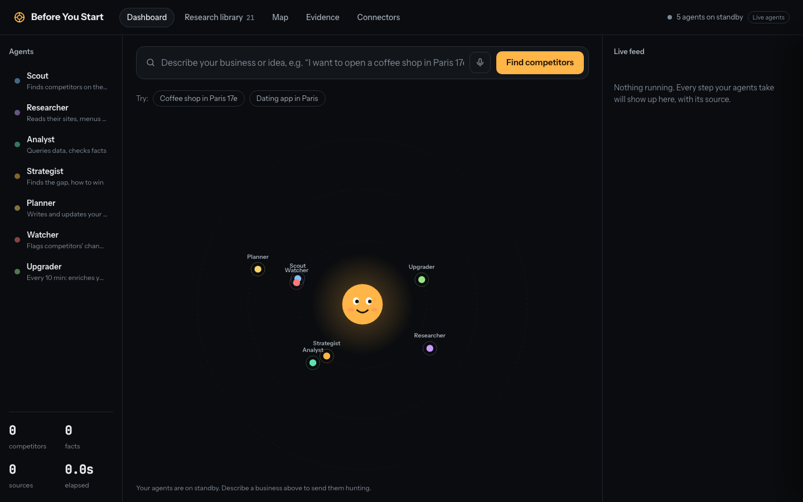
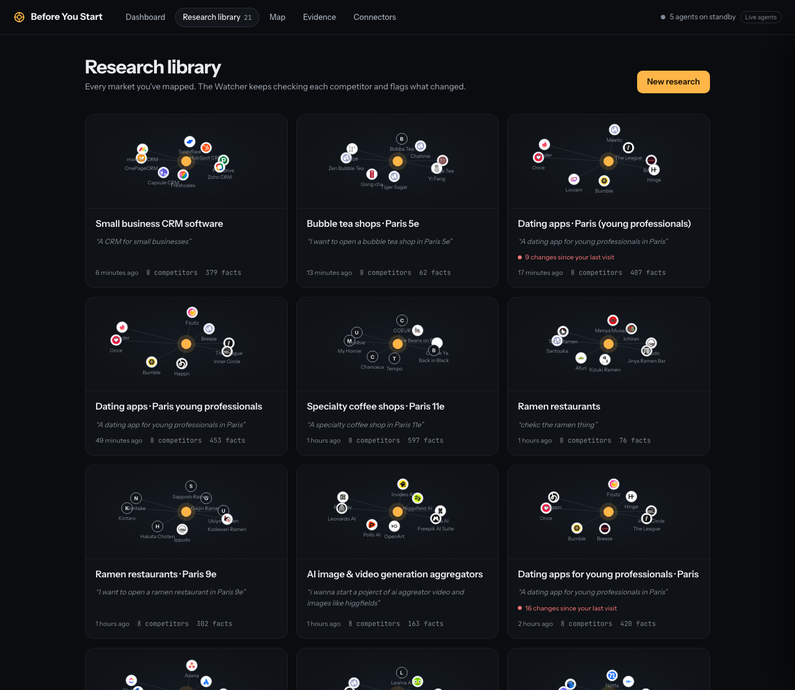
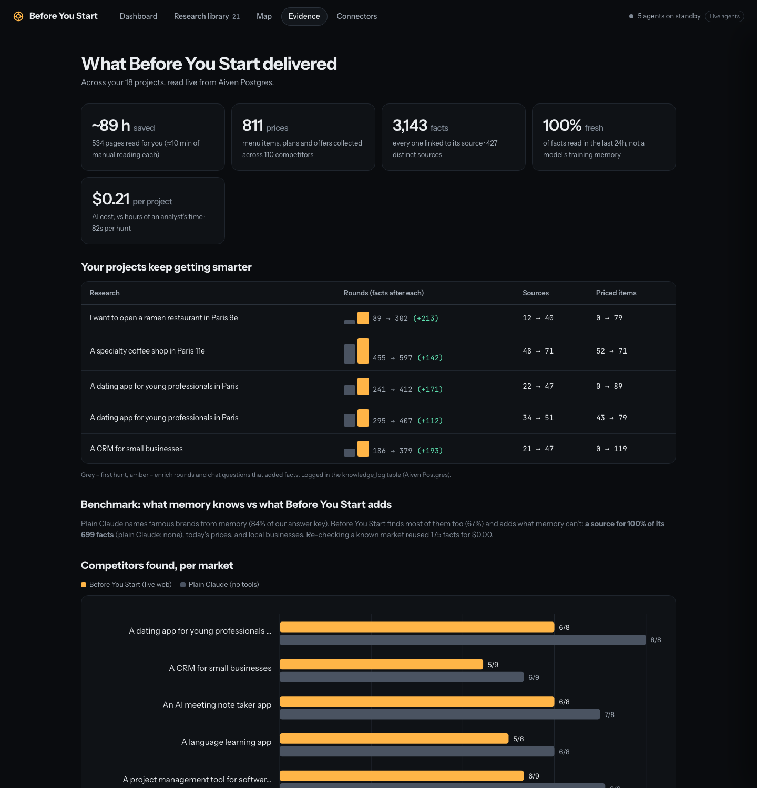
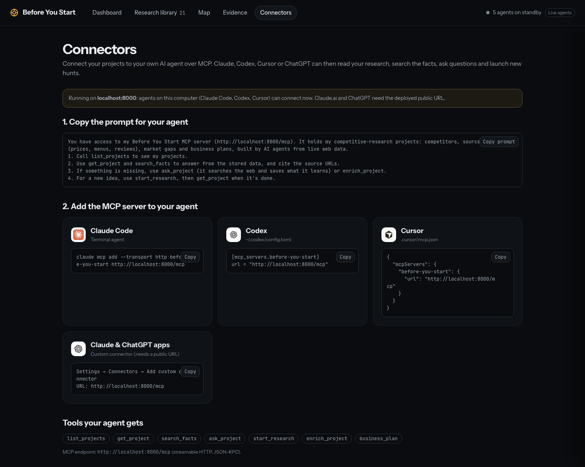
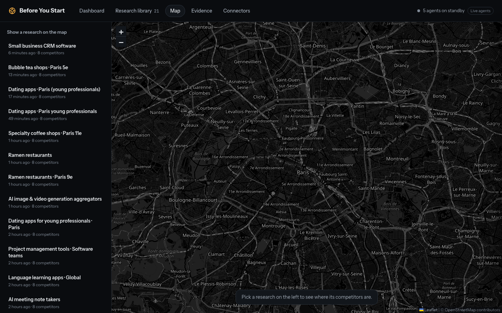

# Before You Start

**Describe your business idea. A team of AI agents maps your real competitors from the live web (prices, menus, reviews, locations, every fact sourced), writes your ideal business plan, and keeps watching the market so the plan gets better every time.**

Built in one day at **Accel AI Innovate Paris** (22 October 2026), challenge *Future Founders: Data-Centric Agents*.

> **Live app:** [https://01a163b2-0176-78f9-8ca3-a1e603657fed-8000.eur-1.aiven.app](https://01a163b2-0176-78f9-8ca3-a1e603657fed-8000.eur-1.aiven.app) (deployed on Aiven Runtime)
>
> **Links:** [Live app](https://01a163b2-0176-78f9-8ca3-a1e603657fed-8000.eur-1.aiven.app) · [Projects](https://01a163b2-0176-78f9-8ca3-a1e603657fed-8000.eur-1.aiven.app/#/library) · [Map](https://01a163b2-0176-78f9-8ca3-a1e603657fed-8000.eur-1.aiven.app/#/map) · [Evidence page](https://01a163b2-0176-78f9-8ca3-a1e603657fed-8000.eur-1.aiven.app/#/evidence) · [Connectors (MCP)](https://01a163b2-0176-78f9-8ca3-a1e603657fed-8000.eur-1.aiven.app/#/connectors) · [Health check](https://01a163b2-0176-78f9-8ca3-a1e603657fed-8000.eur-1.aiven.app/api/health) · [Code on GitHub](https://github.com/ISMMO0/accel-hackathon) · Run locally: see [Run it](#run-it)



---

## The problem

Before launching anything (a ramen shop in Paris 9e, a bubble tea bar near the Sorbonne, a CRM for small businesses) every founder asks the same questions: *who am I up against, what do they charge, where are they, what do their customers hate, and how do I win?* Answering that today means days of googling, review-reading and spreadsheets, and the answer is stale a month later.

## What it does

1. **You describe the idea** (typed or spoken: voice input with ElevenLabs).
2. **Agents hunt live**: they find the real competitors, read their websites, menus, pricing pages and review pages, and store every fact with its source.
3. **You get a report**: the market map, the empty spot ("the gap"), a dossier per competitor, every price and every source.
4. **You get your ideal business plan**: what to charge (item by item, against real competitor prices), where to open (a green zone on the map), how to launch (before, launch week, first 3 months), how to beat each competitor, risks and KPIs.
5. **It keeps getting smarter**: an Upgrader agent enriches your projects in the background, a Watcher flags competitor changes, and the Planner rewrites your plan whenever new data arrives.
6. **Use it from your own agent**: a built-in MCP server lets Claude, Codex, Cursor or ChatGPT query your projects.

| Live hunt | Research library |
|---|---|
|  |  |

| Evidence: what it delivered | Connect your own agent (MCP) |
|---|---|
|  |  |



---

## The agents

| Agent | Job | Model |
|---|---|---|
| **Scout** | Combines what Claude already knows about the market with live web search, reads "best of" guides, picks the real competitors | Claude Opus 5.5 |
| **Researcher** | Reads each competitor's site, menu/pricing and review pages in parallel; extracts facts (price, item, rating, complaint, hours...) | Claude Haiku 5.5 |
| **Analyst** | Places competitors on a market map from the stored facts only; ratings, complaints, locations | Claude Opus 5.5 |
| **Strategist** | Finds the gap and how to beat each competitor | Claude Opus 5.5 |
| **Planner** | Writes the ideal business plan (pricing, location, launch phases, marketing, risks, KPIs), and rewrites it whenever the data changes | Claude Opus 5.5 |
| **Watcher** | Re-reads known pages; only reports *meaningful* changes (prices, plans, offers), not page noise | Claude Haiku 5.5 |
| **Upgrader** | Every 10 minutes, enriches the project that has gone longest without new data (missing prices, menus, reviews, news) | Haiku + Opus |
| **Chat** | Answers questions from the stored facts first (5–14 s); searches the web only when needed and saves what it finds | Claude Opus 5.5 |

Every agent step is streamed live to the UI and stored, so a refresh never loses anything.

## Data at the core

Everything lives in **Aiven PostgreSQL + pgvector**:

- `snapshots`: every page read, with a content hash (unchanged pages are reused with no LLM call).
- `facts`: every fact, its kind, **item and price**, and the snapshot it came from. **A fact cannot be stored without its source** (enforced by the schema).
- `companies`: shared across projects, so knowledge carries over between researches.
- `researches`: query embedding (pgvector) to suggest "continue an existing project", market map, gap, business plan.
- `events`: the live agent feed; `knowledge_log`: facts / sources / priced items after every round; `llm_calls`: cost and latency of every call; `eval_runs`: benchmark results.

Agents never wait on the database: events and writes are batched in the background with retries (built for bad Wi-Fi), and a run is only marked done once every write has landed.

## Evidence it works

Measured live, on real data (Evidence page, and `docs/EVAL_RESULTS.md`):

- **Value delivered so far:** ~80 hours of manual reading saved (495 pages), **690 prices collected**, 2,888 facts from 391 sources, ~$0.17 of AI per project, ~85 s per hunt.
- **Projects get smarter:** one Enrich round took the ramen project from **89 → 302 facts, 12 → 40 sources, 0 → 79 priced menu items** in 76 s.
- **Grounding:** 100% of facts link to a source page (plain Claude: none).
- **Benchmark vs plain Claude** (5 markets, hand-made answer key): plain Claude names famous brands from memory (84%); Before You Start finds most of them too (67%) and adds sources, today's prices and local businesses a model can't know.
- **Memory:** re-checking a known market reuses stored facts; unchanged pages cost nothing.

## Stack and sponsors

| | |
|---|---|
| **Anthropic Claude** | Opus 5.5 (Scout, Analyst, Strategist, Planner, chat), Haiku 5.5 (page reading, Watcher) |
| **Aiven** | PostgreSQL 18 + pgvector (all data and memory), Runtime (deployment) |
| **Keenable** | Web search and page fetch for agents |
| **OpenAI** | Embeddings (pgvector memory match) |
| **ElevenLabs** | Speech-to-text (Scribe) for voice input |
| **MCP** | Built-in server at `/mcp` for Claude Code, Codex, Cursor, ChatGPT |
| App | Python 3.12, FastAPI, asyncpg, Server-Sent Events; vanilla JS + GSAP + Leaflet (no build step) |

## Run it

```bash
cd backend
uv venv --python 3.12 .venv && uv pip install -p .venv/bin/python -r requirements.txt
cp .env.example .env          # add your keys; every key is optional (empty = recorded demo data)
.venv/bin/uvicorn app.main:app --port 8000
```

Open http://localhost:8000. Tests: `MOCK_DELAY=0.05 ANTHROPIC_API_KEY= DATABASE_URL= .venv/bin/python -m scripts.smoke`.
Benchmark: `.venv/bin/python -m scripts.eval` (server running).

**Deploy (Aiven Runtime):** `compose.aiven.yaml` builds `backend/Dockerfile`; set the same variables as `.env` in the Aiven console (plus `MCP_TOKEN` to protect `/mcp`). Live at https://01a163b2-0176-78f9-8ca3-a1e603657fed-8000.eur-1.aiven.app; MCP endpoint `https://01a163b2-0176-78f9-8ca3-a1e603657fed-8000.eur-1.aiven.app/mcp`.

## Docs

- [`docs/ARCHITECTURE.md`](docs/ARCHITECTURE.md): system design
- [`docs/PROGRESS.md`](docs/PROGRESS.md): build log, decisions, measurements (handoff document)
- [`docs/EVAL_RESULTS.md`](docs/EVAL_RESULTS.md): benchmark results
- [`backend/README.md`](backend/README.md): API reference and backend layout
